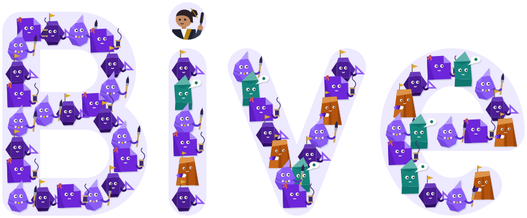

**Agents write, you decide.**

Bive is a repository template for building software with LLM agents in separate roles. Delegates write, a coordinator splits and reviews, an advisor answers read-only questions, and you decide every merge.

- **[Bive](https://github.com/bived-apps/bive)**: the template and the flow. Start here.
- **[Workspace template](https://github.com/bived-apps/milestone-workspace-template)**: a ready-made Bive workspace for one milestone.
- **[Registry](https://bived-apps.github.io/registry/)**: an opt-in count of Bive projects and sessions.
- **[Bench](https://github.com/bived-apps/bench)**: which models behave well in which role, measured.
- **[University](https://github.com/bived-apps/university)**: lessons from real runs, for less skilled models.

 owner  advisor  coordinator  delegate